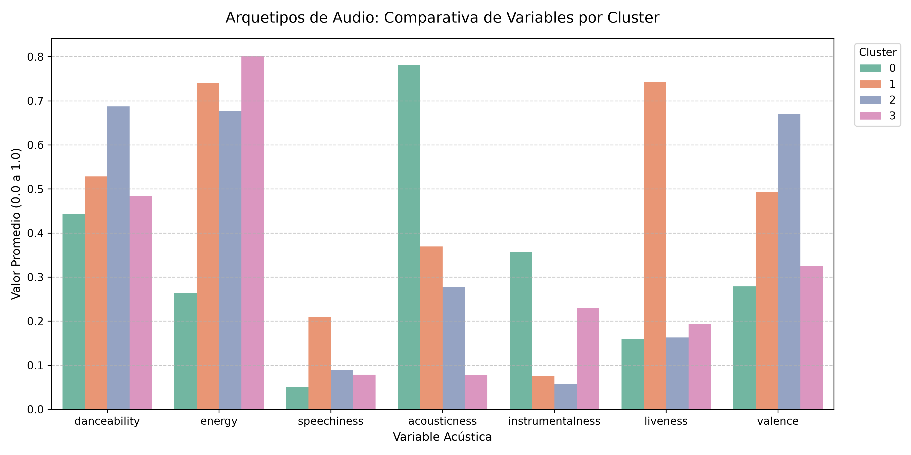

# Spotify Audio Clustering & Playlist Segmentation 

## Business Context
Modern music streaming platforms rely heavily on contextual recommendations. Instead of grouping tracks strictly by genre or artist, this project segments over 89,000 Spotify tracks based purely on their **acoustic fingerprints** (audio features). The goal is to discover underlying sonic archetypes to power mood-based and context-aware playlist generation.

## Methodology
1. **Data Preprocessing:** Cleaned and standardized 9 numerical audio features (Danceability, Energy, Valence, Acousticness, etc.) using `StandardScaler` to eliminate scale variance.
2. **Optimal K Selection:** Applied the Elbow Method and Silhouette Analysis to determine the optimal number of clusters ($k=4$).
3. **Clustering:** Implemented unsupervised K-Means clustering to partition the dataset.
4. **Profiling:** Extracted the mean values of each feature per cluster to define actionable product archetypes.

## The 4 Sonic Archetypes

Based on the multidimensional analysis, the algorithm identified the following track profiles:

* **Cluster 0: Acoustic & Chill Focus** 
  * *High acousticness, low energy.* Ideal for studying, reading, or relaxing.
* **Cluster 1: High-Energy Workout & Party**  
  * *Peak energy, high danceability, and high loudness.* Designed for gym sessions or club environments.
* **Cluster 2: Moody & Melancholic Late Night**  
  * *Low valence (sadness/melancholy), moderate tempo.* Perfect for late-night drives or emotional listening.
* **Cluster 3: Instrumental & Ambient Soundscapes**  
  * *High instrumentalness, low speechiness.* Ambient tracks with minimal vocals for deep work.

## Visualizations

*(Note: Ensure your images are saved in the `/reports` folder to render correctly here)*

### Feature Correlation Matrix

### Archetype Comparison

## Tech Stack
* **Python** (Pandas, NumPy)
* **Scikit-Learn** (K-Means, StandardScaler)
* **Matplotlib & Seaborn** (Data Visualization)
